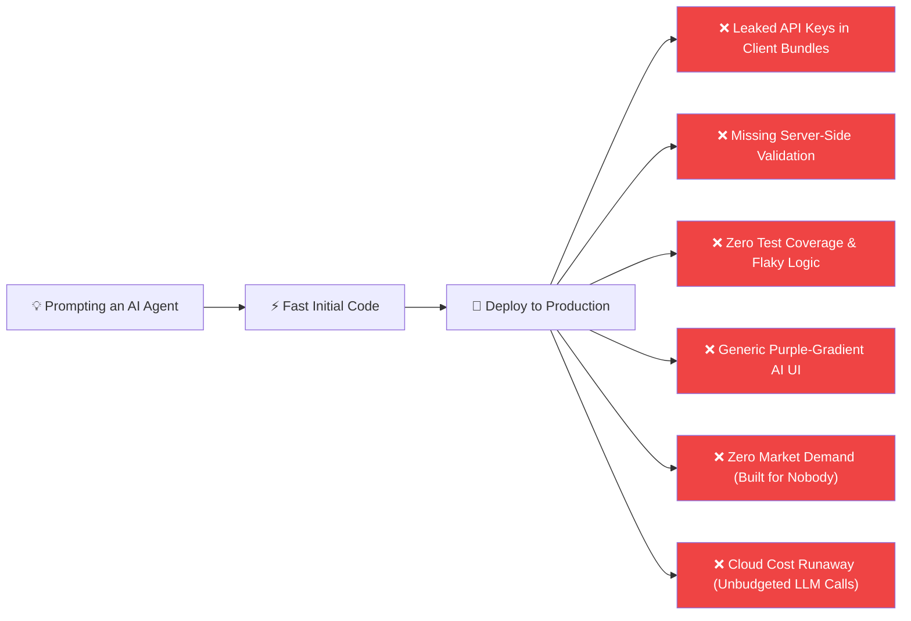
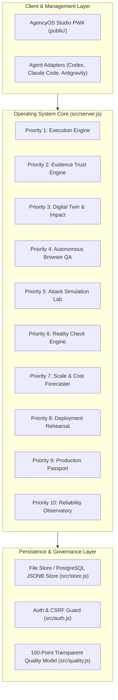

# 🚀 vibe-to-prod

> **The Next-Generation AI Engineering Operating System.**  
> *Transforming AI vibe coding into observable, tested, secured, cost-forecasted, and production-ready software.*

[](LICENSE)
[](https://nodejs.org)
[]()
[]()

---

## 📌 Table of Contents

- [The Problem: The Vibe Coding Trap](#-the-problem-the-vibe-coding-trap)
- [What is vibe-to-prod?](#-what-is-vibe-to-prod)
- [The 10 Strategic Priorities (Next-Gen OS Kernel)](#-the-10-strategic-priorities-next-gen-os-kernel)
  - [Priority 1: Real Agent Execution Engine](#priority-1--real-agent-execution-engine)
  - [Priority 2: Evidence Trust Engine](#priority-2--evidence-trust-engine)
  - [Priority 3: Engineering Digital Twin](#priority-3--engineering-digital-twin)
  - [Priority 4: Autonomous Browser QA](#priority-4--autonomous-browser-qa)
  - [Priority 5: Attack Simulation Lab](#priority-5--attack-simulation-lab)
  - [Priority 6: Reality Check Engine](#priority-6--reality-check-engine)
  - [Priority 7: Cost and Scale Forecaster](#priority-7--cost-and-scale-forecaster)
  - [Priority 8: Deployment Rehearsal](#priority-8--deployment-rehearsal)
  - [Priority 9: Production Passport](#priority-9--production-passport)
  - [Priority 10: Agent Reliability Observatory](#priority-10--agent-reliability-observatory)
- [High-Level Design (HLD)](#-high-level-design-hld)
- [Low-Level Design (LLD)](#-low-level-design-lld)
- [The 17-Skill Intelligence Suite](#-the-17-skill-intelligence-suite)
- [Quality Engine & 100-Point Scoring Model](#-quality-engine--100-point-scoring-model)
- [Quick Start & Installation](#-quick-start--installation)
- [Verification & Testing](#-verification--testing)
- [License](#-license)

---

## 🛑 The Problem: The Vibe Coding Trap

With the explosion of autonomous AI coding agents (Claude Code, OpenAI Codex, Cursor, Antigravity, GitHub Copilot), anyone can generate thousands of lines of full-stack code in a single prompt session. This phenomenon is called **vibe coding**.

However, shipping raw vibe-coded projects to production introduces critical engineering and business liabilities:



### The Hard Truths:
1. **Unvalidated Hypotheses:** Founders spend weeks vibe-coding complex features only to discover zero users are willing to pay for them.
2. **Leaked Credentials:** Agents frequently commit `.env` secrets, hardcode Stripe or cloud keys into frontend bundles, or prefix sensitive keys with `NEXT_PUBLIC_` / `VITE_`.
3. **Client-Side-Only Security:** Agents write form validation and auth guards in the frontend, leaving backend mutation APIs exposed to unauthorized direct execution.
4. **Context Rot & Drift:** As conversation tokens grow beyond 50k, the AI loses focus, contradicts its own architectural decisions, and introduces silent regressions.
5. **Interview & Presentation Blindspots:** Developers who vibe-code an app often cannot explain time complexity, database queries, or security boundaries when questioned by clients, investors, or interviewers.

---

## 💡 What is vibe-to-prod?

**`vibe-to-prod`** is an **AI Engineering Operating System** that wraps around autonomous AI coding agents. It ensures that every line of code generated by an AI model adheres to the standards of a staff-level engineering team before it is ever merged or deployed.

It operates in three interconnected layers:
- **Core Operating System Kernel (`src/`):** Real agent execution, evidence trust engine, continuous digital twin, autonomous browser QA, attack simulation, empirical reality checks, scale forecasting, staging rehearsal, release passports, and observability.
- **17-Skill Intelligence Suite (`skills/` & `.agents/skills/`):** Provider-independent skills compatible with **Codex**, **Claude Code**, and **Gemini / Antigravity**.
- **Studio Interface (`public/`):** An observable, real-time web dashboard (and installable PWA) for tracking tasks, visualizing quality scores, reviewing diff proposals, and releasing software.

---

## 🎯 The 10 Strategic Priorities (Next-Gen OS Kernel)

### Priority 1 — Real Agent Execution Engine
*No fabricated agent runs. Real execution, real status, real observability.*
- **DAG Topological Ordering:** Resolves task dependencies and schedules execution in topological order with circular dependency detection.
- **Idempotency Keys:** Deterministic idempotency keys prevent duplicate task execution.
- **Approval Checkpoints:** Pauses execution at human-in-the-loop checkpoints until explicitly approved via API or Studio.
- **Context Handoff:** Cryptographic SHA-256 context hashing passes state safely between workflow phases.
- **Exponential Backoff:** Configurable retry policies with jitter and cancellation handling.

### Priority 2 — Evidence Trust Engine
*A text description must never be sufficient to prove an automated check passed.*
- **Repository Fingerprinting:** Deterministic SHA-256 hashing detects uncommitted changes and code drift.
- **7-State Verification Taxonomy:** Explicitly distinguishes `verified`, `partially_verified`, `user_reported`, `unverified`, `failed`, `not_applicable`, and `stale`.
- **Zero-Bypass Policy:** Automated checks score **0 points** unless backed by a verifiable artifact, raw log, or machine exit code.

### Priority 3 — Engineering Digital Twin
*Continuously updated graph representation of target application health.*
- **Graph Topology:** Extracts modules, components, API endpoints, database entities, dependencies, security boundaries, ADRs, and tests.
- **7-Step Change Impact Analysis:** On any code change, identifies affected modules, impacted APIs, related tests, threatened boundaries, violated ADRs, and recommends the smallest verification test suite.

### Priority 4 — Autonomous Browser QA
*Playwright-powered route discovery and critical journey verification.*
- **Automated Discovery:** Crawls static routes, client-side router declarations, and interactive forms.
- **Responsive Multi-Breakpoint Captures:** Captures visual proof at 360px (mobile), 768px (tablet), and 1280px (desktop).
- **Accessibility & Bug Reports:** Discovers missing ARIA labels, unlabelled inputs, and generates reproducible bug reports.

### Priority 5 — Attack Simulation Lab
*Safe, authorized security verification before deployment.*
- **Security Headers:** Audits CSP (`unsafe-inline`, `unsafe-eval`), HSTS, X-Content-Type-Options, X-Frame-Options, and dangerous CORS wildcard credentials.
- **Boundary & IDOR Testing:** Tests unauthenticated mutation access and cross-tenant direct object references.
- **CSRF & Session Security:** Verifies CSRF token enforcement and cookie attributes (`HttpOnly`, `Secure`, `SameSite`).
- **Production Guard:** Intrusive tests are strictly prohibited against production without explicit `allowProduction: true` confirmation.

### Priority 6 — Reality Check Engine
*Separating synthetic hypotheses from empirical customer demand.*
- **7-Tier Evidence Hierarchy:**
  1. `synthetic_hypotheses` (Max confidence 20%, strictly exploratory)
  2. `competitor_research`
  3. `public_market_evidence`
  4. `real_customer_interviews`
  5. `landing_page_experiments`
  6. `waitlist_conversion`
  7. `actual_purchase_and_usage` (Gold standard)
- **Anti-Fabrication Guard:** Never invents conversion probabilities or claims statistical significance without sample sizes >= 100 real visitors or 30 paying users.

### Priority 7 — Cost and Scale Forecaster
*Deterministic capacity and cloud burn modeling based on verified public rates.*
- **Multi-Scale Modeling:** Simulates 100, 1,000, 10,000, and 100,000 active users.
- **7 Resource Dimensions:** API requests, database operations, storage, bandwidth egress, background worker jobs, AI inference tokens, and compute hosting.
- **Bottleneck Detection:** Flags database connection pool limits at 10k users and un-cached LLM spend dominance at 100k users with clear architecture evolution paths.

### Priority 8 — Deployment Rehearsal
*Staging pre-flight drill before releasing to production.*
- **Checkpoints:** Configuration validation, secret leak scan, reversible migration down check, backup freshness verification (< 24h RPO), health endpoint probes, and downstream dependency checks.
- **Release Risk Scorecard:** Outputs `releaseReady: boolean`, `riskLevel: 'low' | 'medium' | 'high' | 'critical'`, and active blockers.

### Priority 9 — Production Passport
*Reproducible, machine-readable and audit-ready release evidence package.*
- **Complete SBOM:** Full Software Bill of Materials with licenses and dependency breakdown.
- **Attestation Signature:** Signed with a cryptographic SHA-256 hash of the canonical release record.
- **Dual Export:** Available in machine-readable JSON (`passport.json`) and audit-ready Markdown (`passport.md`).

### Priority 10 — Agent Reliability Observatory
*Continuous telemetry tracking orchestration and agent reliability.*
- **Telemetry Metrics:** Success rate, task completion time, retry frequency, tool errors, context handoff failures, token cost, human interventions, and quality delta.
- **Skill Reliability Rankings:** Identifies underperforming skills (`rock_solid`, `stable`, `flaky`, `critical_attention`) to pinpoint prompt regressions.

---

## 🏗️ High-Level Design (HLD)



---

## ⚙️ Low-Level Design (LLD)

### 1. Data Models & Store
- **Local Mode (`src/store.js`):** Lightweight JSON storage engine utilizing atomic file renaming with serialized mutation queues to eliminate file lock contention.
- **PostgreSQL Mode (`src/postgres-store.js`):** JSONB storage with advisory locking for multi-instance deployments, signed 8-hour sessions, and scrypt password hashing.

### 2. DAG Execution Engine (`src/execution/`)
```
Workflow Initialized
        │
        ▼
Dependency Graph (Topological Sorter)
        │
        ├─► Task 1 (Foundation) ──► Context Handoff Hash
        │                                  │
        ▼                                  ▼
Approval Checkpoint? ──(Yes)──► Paused ──(Approved)──► Task 2 (Implementation)
        │
        ▼
Execution Metrics & Telemetry Recorded
```

---

## 🧠 The 17-Skill Intelligence Suite

All skills are located in `skills/` and synchronized to `.agents/skills/` (Codex/Antigravity) and `.claude/skills/` (Claude Code):

| Skill Name | Role | Primary Capability |
| :--- | :--- | :--- |
| **synthetic-customer-simulator** | Product Discovery | Stress-tests concepts across customer personas with strict evidence tiers |
| **vibe-security-audit** | DevSecOps | Scans git history, client bundles, and HTTP headers for leaked secrets |
| **design-md-extractor** | UI Architecture | Reverse-engineers design tokens, color systems, and typography into `DESIGN.md` |
| **multi-agent-interview-panel** | Tech Readiness | 5-agent panel (Architect, SecOps, QA, Product, Senior Dev) grilling the author |
| **fullstack-architecture** | Staff Architect | Defines clean boundaries, schema definitions, and ADRs |
| **app-security** | Application Security | Zero-trust authentication, RBAC, CSRF, and SQL injection defenses |
| **testing-strategy** | QA Director | Enforces unit, integration, and critical user journey tests |
| **pwa-offline-engine** | Mobile / Offline | Service worker caching, IndexedDB sync, and installable manifests |
| **responsive-ui** | UI / Accessibility | WCAG AA compliance, semantic HTML, and fluid viewport layouts |
| **seo-and-social** | Growth | Dynamic OpenGraph images, sitemaps, JSON-LD structured data |
| **database-modeling** | Database Architect | Third normal form schemas, foreign keys, index optimization |
| **api-design** | Backend Lead | RESTful standards, error envelope formats, idempotent mutations |
| **performance-optimization** | Core Web Vitals | LCP < 2.5s, code-splitting, tree-shaking, asset optimization |
| **animation-interaction** | Motion Designer | CSS transforms, spring physics, reduced-motion media queries |
| **deployment-delivery** | DevOps Lead | Docker multi-stage builds, healthchecks, zero-downtime rollbacks |
| **logging-observability** | SRE Lead | Structured JSON logging, correlation IDs, OpenTelemetry hooks |
| **technical-debt-cleanup** | Senior Refactorer | Eliminates dead code, resolves lint errors, enforces strict types |

---

## 📊 Quality Engine & 100-Point Scoring Model

`vibe-to-prod` evaluates software across 12 weighted engineering categories:

| Category | Weight | Primary Verifications |
| :--- | :---: | :--- |
| **Application Security** | 12 | Secret scan, npm audit, Attack Lab simulation |
| **Architecture & System Design** | 12 | Digital Twin graph, modular boundaries, ADRs |
| **UI/UX & Visual Design** | 10 | DESIGN.md compliance, visual review captures |
| **Authentication & AuthZ** | 9 | CSRF protection, session cookie flags, IDOR tests |
| **Responsive Design & A11y** | 8 | WCAG AA checks, static & rendered accessibility |
| **Scalability & Reliability** | 8 | Cost & scale forecaster, rate limiting |
| **SEO & Discoverability** | 8 | Static metadata, canonical URLs, robots checks |
| **Testing & QA** | 7 | Real Node.js test exit code, Autonomous Browser QA |
| **Animation & Interaction** | 6 | Motion design, accessible transition controls |
| **Performance** | 6 | Rendered LCP, DOMContentLoaded, transfer bytes |
| **Offline & Synchronization** | 5 | Service workers, offline cache manifests |
| **Deployment & Observability** | 4 | Deployment rehearsal, staging preflight drill |
| **Total** | **100** | |

> ⚠️ **Zero-Bypass Policy:** A high numerical score does NOT permit release if critical blockers exist. A release is blocked if any critical vulnerability, leaked credential, or broken auth boundary is detected.

---

## 🚀 Quick Start & Installation

### 1. Run Locally
```bash
# Clone the repository
git clone https://github.com/raviattrash-pro/vibe-to-prod.git
cd vibe-to-prod

# Install dependencies
npm install

# Start the server and Studio interface
npm start
# Open http://localhost:4173 in your browser
```

### 2. Run with Docker Compose
```bash
docker compose up -d
# Studio is available at http://localhost:4173
```

### 3. Install Skills into Any Existing Project
```bash
# Automatically install all 17 skills into your target project
npm run install:project -- "C:/path/to/your/project"
```

---

## 🧪 Verification & Testing

Every capability in `vibe-to-prod` is verified with comprehensive unit and integration tests:

```bash
# Run 100 unit, integration, and safety tests
npm test

# Run repository integrity validation
npm run validate

# Synchronize skills across agent runtimes
npm run sync:skills
```

---

## 📄 License

This project is licensed under the [MIT License](LICENSE).
