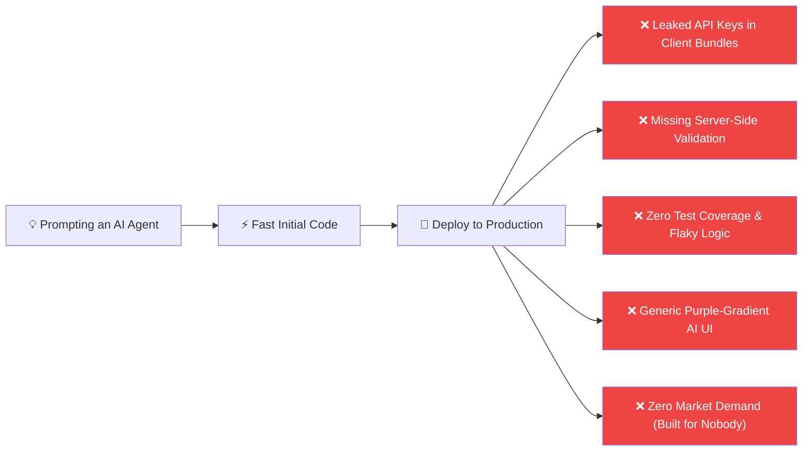
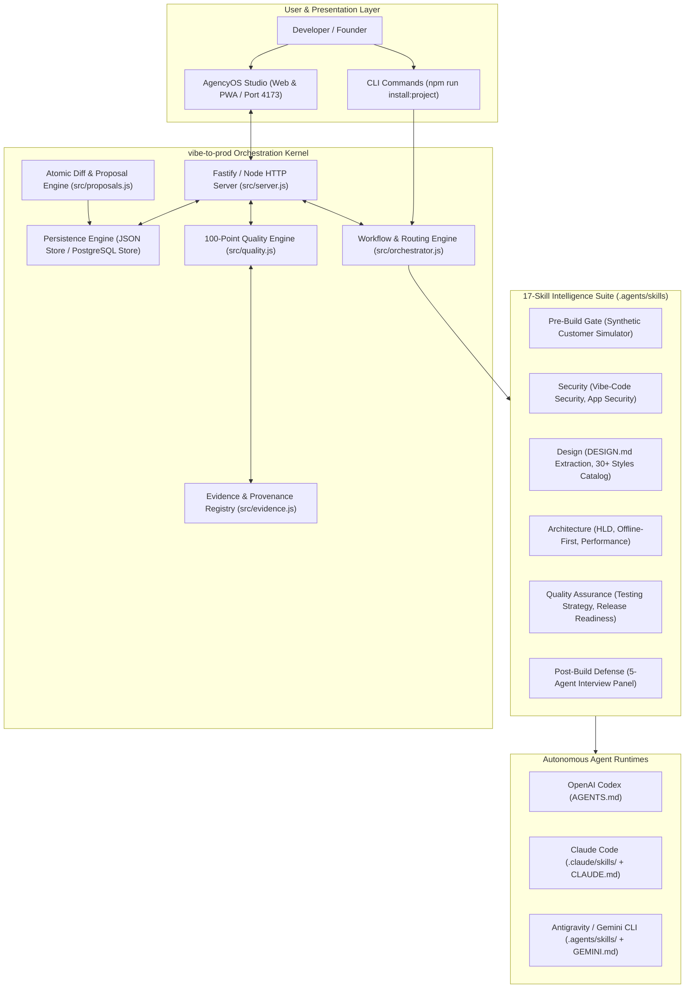

# 🚀 vibe-to-prod

> **Turn AI-generated code into agency-grade software.**
> *Pre-build customer simulation, vibe-security auditing, DESIGN.md extraction, and automated quality gates for Codex, Claude Code & Antigravity.*

[](LICENSE)
[](https://nodejs.org)
[]()
[]()

---

## 📌 Table of Contents

- [The Problem: The Vibe Coding Trap](#-the-problem-the-vibe-coding-trap)
- [What is vibe-to-prod?](#-what-is-vibe-to-prod)
- [Why vibe-to-prod?](#-why-vibe-to-prod)
- [High-Level Design (HLD)](#-high-level-design-hld)
- [Low-Level Design (LLD)](#-low-level-design-lld)
- [The 17-Skill Intelligence Suite](#-the-17-skill-intelligence-suite)
- [How It Works: Step-by-Step Flow](#-how-it-works-step-by-step-flow)
- [Quick Start & Installation](#-quick-start--installation)
  - [Run Locally](#run-locally)
  - [Run with Docker Compose](#run-with-docker-compose)
  - [Install into Any Project](#install-into-any-project)
- [Quality Engine & 100-Point Model](#-quality-engine--100-point-model)
- [Verification & Testing](#-verification--testing)
- [Roadmap & Contributing](#-roadmap--contributing)

---

## 🛑 The Problem: The Vibe Coding Trap

With the explosion of AI coding assistants (Claude Code, OpenAI Codex, Cursor, Antigravity, GitHub Copilot), anyone can generate a full-stack application in a few prompts. This phenomenon is called **vibe coding**.

However, shipping vibe-coded projects to production introduces massive hidden liabilities:



### The Hard Truths:
1. **Unvalidated Ideas:** Founders spend weeks vibe-coding complex features only to find zero users want to pay for them.
2. **Leaked Credentials:** Agents frequently commit `.env` files, hardcode AWS/Stripe keys into React/Vite source files, or prefix sensitive keys with `NEXT_PUBLIC_` / `VITE_`.
3. **Client-Side-Only Security:** Agents write form validation and auth guards in the frontend, leaving the backend API completely exposed to direct manipulation.
4. **Context Rot & Drift:** As conversation tokens grow beyond 50k, the AI loses focus, contradicts its own architectural decisions, and introduces silent regressions.
5. **Interview & Presentation Blindspots:** Developers who vibe-code an app often cannot explain time complexity, memory implications, or trade-offs when questioned in client reviews or tech interviews.

---

## 💡 What is vibe-to-prod?

**`vibe-to-prod`** is an **engineering operating system and quality kernel** that wraps around your AI coding agents. It ensures that every line of code generated by an AI model adheres to the standards of a staff-level engineering team before it is ever merged or deployed.

It operates in two connected parts:
- **Core Engine:** 17 provider-independent skills, evidence-backed quality verification, synthetic customer simulation, and automated release gates compatible with **Codex**, **Claude Code**, and **Gemini/Antigravity**.
- **Studio Interface:** An observable, real-time web dashboard (and installable PWA) for tracking tasks, visualizing quality scores, reviewing diff proposals, and managing releases.

---

## 🎯 Why vibe-to-prod?

| Traditional AI Generation (Vibe Coding) | vibe-to-prod Operating Model |
| :--- | :--- |
| **Starts coding immediately** without market validation | **Simulates 100 customer personas** first: gives a definitive Build vs Kill verdict |
| **Client-side only validation** & exposed `.env` keys | **Vibe-Code Security Audit** scans git history, headers, and client bundles |
| **Generic, template-like UI** with repetitive gradients | **`DESIGN.md` extraction** & 30+ visual styles (Bento, Brutalism, Glassmorphism) |
| **Unbounded, single-turn prompts** causing context rot | **Structured Plan-Execute-Verify loops** with phase handoffs |
| **Self-congratulatory AI claims** ("Everything is tested!") | **Evidence-backed scoring**: claims score 0 points without verifiable logs |
| **Developer can't explain** how the system works | **5-Agent Interview Panel** grills the developer so they master their own code |

---

## 🏗️ High-Level Design (HLD)

`vibe-to-prod` acts as the supervisory orchestrator between the user, their workspace, and autonomous coding agents:



---

## ⚙️ Low-Level Design (LLD)

### 1. Data Models & Store
- **Local Mode (`src/store.js`):** Lightweight JSON storage engine utilizing atomic file renaming with serialized mutation queues to eliminate file lock contention.
- **Enterprise Mode (`src/postgres-store.js`):** PostgreSQL JSONB backend for multi-user teams, supporting transaction-safe updates, RBAC, and signed 8-hour sessions with scrypt password hashing.

### 2. Workflow Routing Engine (`src/orchestrator.js` & `references/workflow-routing.json`)
The orchestrator dynamically routes tasks into dependency-ordered DAGs based on project intent:
```
Project Created ──> Foundation / Repository Audit
                         │
                         ▼
        ┌────────────────┴────────────────┐
        ▼                                 ▼
Pre-Build Customer Sim          Architecture / HLD
        │                                 │
        ▼                                 ▼
Design Intelligence / DESIGN.md ──> Implementation / Coding
                                          │
                                          ▼
                               Vibe-Code Security Audit
                                          │
                                          ▼
                                Testing & Performance
                                          │
                                          ▼
                                   Release Readiness
                                          │
                                          ▼
                            Multi-Agent Interview Panel
```

### 3. Change Proposal & Remediation Engine (`src/proposals.js`)
- Code remediations are never applied silently.
- Single-file unified diff proposals are generated with cryptographic SHA-256 fingerprints.
- The engine checks original file hashes prior to atomic patching to prevent race conditions or stale writes.

---

## 🧠 The 17-Skill Intelligence Suite

Every skill is a standalone, discoverable markdown specification accompanied by validation criteria, input requirements, actionable procedures, and explicit anti-patterns:

```
.agents/skills/
├── agencyos/                     # Master orchestrator & 6-phase engineering lifecycle
├── synthetic-customer-simulator/ # 100 synthetic customer persona validation (Build vs Kill)
├── vibe-code-security/           # Catches leaked API keys, .env commits, prompt injection
├── agent-workflow-orchestration/ # Plan-execute-verify loops, context rot mitigation
├── design-reference-extraction/  # Generates binding DESIGN.md from reference URLs
├── design-styles-catalog/        # 30+ visual styles (Bento, Neumorphism, Brutalism)
├── repository-audit/             # Codebase reconnaissance, lockfile and script audit
├── hld/                          # High-level architecture, C4 diagrams, ADR records
├── design-intelligence/          # WCAG AA contrast tokens, typography, responsive grids
├── application-security/         # Threat modeling, OWASP Top 10, CORS, auth guards
├── seo/                          # Technical SEO, JSON-LD schema, robots.txt, sitemaps
├── performance/                  # Core Web Vitals (LCP, INP, CLS), bundle size budgets
├── offline-first/                # IndexedDB/Cache API sync, conflict resolution
├── pwa-mobile-app/               # Manifest, 192px/512px icons, scoped service worker
├── testing-strategy/             # Testing pyramid, critical journey test execution
├── release-readiness/            # Pre-flight gate checklist with go/no-go recommendation
└── multi-agent-interview-panel/  # 5-agent technical interview grill for portfolio defense
```

---

## 🔄 How It Works: Step-by-Step Flow

### Phase 1: Pre-Build Validation
Before writing code, trigger the **Synthetic Customer Simulator**:
```bash
# In your agent session:
"Validate my idea: A subscription tool that monitors API rate limits for $29/month."
```
100 synthetic user personas evaluate pricing elasticity, friction points, and alternative tools, delivering a clear verdict:
- 🟢 **GREEN / BUILD** (Conversion > 40%)
- 🟡 **AMBER / PIVOT** (Adjust positioning or price point)
- 🔴 **RED / DO NOT START** (Save weeks of wasted coding)

### Phase 2: Design Extraction
Prevent the generic AI look by feeding a reference site to **Design Reference Extraction**:
```bash
"Extract design reference from https://linear.app into DESIGN.md"
```
Produces a structured, concise `DESIGN.md` containing strict **Do's & Don'ts**, color tokens, typography scales, and padding rules.

### Phase 3: Phased Agent Orchestration
Break monolithic prompts into structured **Plan-Execute-Verify** loops via `agent-workflow-orchestration`. Each phase operates under a 60% context window ceiling to eliminate context rot.

### Phase 4: Vibe-Code Security Audit
Audit the generated codebase:
```bash
"Run vibe-code-security audit"
```
Scans git commit history for accidentally committed `.env` files, inspects client bundles for leaked keys, and verifies server-side route guards.

### Phase 5: Evidence-Backed Quality Score
Every check requires proof:
- Automated test output, `npm audit` parser results, or headless screenshot captures.
- No AI self-assertion is accepted as evidence.

### Phase 6: Multi-Agent Interview Panel
Once built, get grilled by 5 specialist personas (Architect, Security, PM, QA, Engineering Manager) on your actual code to prepare for technical interviews and presentations.

---

## 🚀 Quick Start & Installation

### Prerequisites
- **Node.js**: v20.0.0 or higher
- **Package Manager**: npm (bundled with Node)

### Run Locally
```bash
# 1. Clone the repository
git clone https://github.com/raviattrash-pro/vibe-to-prod.git
cd vibe-to-prod

# 2. Start the local server
npm start
```
Open **`http://localhost:4173`** to access AgencyOS Studio.

---

### Run with Docker Compose
```bash
# 1. Prepare environment configuration
cp .env.example .env

# 2. Launch with PostgreSQL persistence
docker compose up --build -d
```
The application will listen on `http://127.0.0.1:4173` backed by PostgreSQL.

---

### Install into Any Existing Project
Inject the 17 skills and instruction sets into any existing repo:
```bash
npm run install:project -- "C:\path\to\your-project"
```
This automatically configures:
- `.agents/skills/` (for Antigravity / Gemini CLI)
- `.claude/skills/` (for Claude Code)
- Managed instruction blocks in `AGENTS.md`, `CLAUDE.md`, and `GEMINI.md`.

---

## 📊 Quality Engine & 100-Point Model

Every project is evaluated against a transparent 100-point rubric:

| Category | Weight | Description |
| :--- | :---: | :--- |
| **Application Security** | 14 | Vulnerabilities, secrets, headers, auth controls |
| **UI/UX & Visual Design** | 12 | Design system, token consistency, originality |
| **Responsive & Accessibility** | 10 | WCAG AA contrast, responsive breakpoints, ARIA |
| **SEO & AI Discoverability** | 10 | Semantic HTML, JSON-LD, crawlability, canonicals |
| **Architecture & System Design** | 10 | Component boundaries, data flows, ADRs |
| **Authentication & Authorization** | 8 | Login flows, RBAC, session management, IDOR |
| **Scalability & Reliability** | 8 | Error handling, graceful degradation |
| **Testing & QA** | 7 | Test coverage, critical journey suites |
| **Animation & Interaction** | 6 | Motion design, reduced-motion compliance |
| **Performance** | 6 | Core Web Vitals (LCP, INP, CLS), bundle size |
| **Offline & Synchronization** | 5 | Local storage, retry queues, conflict policy |
| **Deployment & Observability** | 4 | CI/CD, logging, rollback procedures |
| **Total** | **100** | |

> ⚠️ **Release Blocker Rule:** Regardless of numerical score, release readiness is strictly blocked if any critical security vulnerability (P0/P1), exposed secret, or broken authentication control is identified.

---

## 🧪 Verification & Testing

Run the full verification suite:
```bash
# Run 49 unit and integration tests
npm test

# Run project integrity and reference validation
npm run validate

# Sync skills across agent providers
npm run sync:skills
```

---

## 🗺️ Roadmap

- [x] **v0.1.0:** Core 17-skill suite, local JSON & PostgreSQL stores, Studio PWA, evidence registry.
- [ ] **v0.2.0:** Headless browser automation for multi-page automated screenshot diffing.
- [ ] **v0.3.0:** Direct GitHub Actions integration for automated PR quality gate checks.
- [ ] **v0.4.0:** Interactive terminal UI (TUI) for local CLI agent orchestration.

---

## 📄 License

This project is licensed under the [MIT License](LICENSE).
