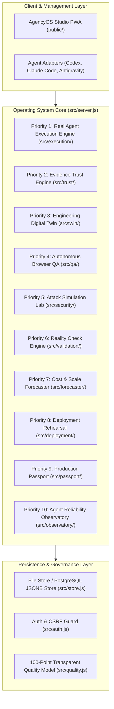

# vibe-to-prod — System Architecture

**vibe-to-prod** is a next-generation AI Engineering Operating System that bridges the gap between raw AI-generated code ("vibe coding") and observable, verified, production-grade software.

---

## 🏗️ Next-Generation Operating System Topology

---

## 🧩 Architectural Subsystems

### 1. Real Agent Execution Engine (`src/execution/`)
- **DAG Topological Sorter (`engine.js`):** Resolves task dependency graphs, checks execution readiness, and detects circular dependency locks.
- **Idempotency & State (`state.js`):** Unique idempotency keys prevent duplicate runs. Manages session states (`pending`, `running`, `paused_for_approval`, `completed`, `failed`, `cancelled`).
- **Context Handoff (`handoff.js`):** Cryptographic SHA-256 context hashing passes state safely between workflow phases.
- **Provider Runner Adapters:** Direct integration with Codex, Claude Code, and Antigravity runners with exponential backoff retries and manual approval checkpoints.

### 2. Evidence Trust Engine (`src/trust/`)
- **Content Fingerprinting:** Deterministic SHA-256 repo fingerprinting detects uncommitted code drift.
- **7-State Verification Taxonomy:**
  1. `verified` (Automated tool proof with verifiable artifact hash)
  2. `partially_verified`
  3. `user_reported`
  4. `unverified`
  5. `failed`
  6. `not_applicable`
  7. `stale` (Expired TTL or repo modification mismatch)
- **Anti-Fabrication Zero-Bypass Policy:** Bare text descriptions alone can NEVER prove an automated check passed without machine-verifiable artifact proof.

### 3. Engineering Digital Twin (`src/twin/`)
- **Knowledge Graph (`graph.js`):** Continuously models dependencies, modules, components, API endpoints, database entities, security boundaries, ADRs, and test suites.
- **7-Step Change Impact Analyzer (`impact.js`):** Traces git diffs to identify affected modules, impacted APIs, related tests, threatened boundaries, and violated ADRs, recommending the smallest verification suite.

### 4. Autonomous Browser QA (`src/qa/`)
- **Route & Critical Journey Discovery (`browser.js`):** Discovers static routes, router definitions, form interactions, and auth entrypoints.
- **Multi-Breakpoint Visual Capture:** Captures responsive screenshots at 360px (mobile), 768px (tablet), and 1280px (desktop).
- **Accessibility & Bug Reports:** Extracts missing ARIA tags, button names, form labels, and generates structured, reproducible bug reports.

### 5. Attack Simulation Lab (`src/security/`)
- **Authorized Threat Simulation (`attack-lab.js`):**
  - Security header audits (CSP, HSTS, X-Content-Type-Options, X-Frame-Options, CORS wildcard with credentials).
  - Authorization boundaries & IDOR probing.
  - CSRF protection verification on mutating routes.
  - Session cookie flags (`HttpOnly`, `Secure`, `SameSite`).
  - Rate-limit testing under burst traffic.
  - Adversarial input validation (SQL injection, path traversal, XSS).
  - File upload controls (extension whitelist, size limits).
- **Production Guard:** Strictly blocks intrusive testing against production without explicit confirmation.

### 6. Reality Check Engine (`src/validation/`)
- **Multi-Tier Empirical Market Validation (`reality-check.js`):**
  - Strictly separates synthetic hypotheses from real customer interviews, competitor research, landing page smoke tests, waitlist conversions, and actual telemetry.
  - Rejects simulated customer persona behavior as measured market demand (max confidence 20%).
  - Enforces sample size criteria before claiming statistical significance.
  - Extracts assumptions, unknowns, and recommended experiments.

### 7. Cost & Scale Forecaster (`src/forecaster/`)
- **Capacity & Burn Modeling (`scale.js`):**
  - Models infrastructure at 100, 1,000, 10,000, and 100,000 active users.
  - Breakdowns for API requests, database operations, storage, bandwidth, background jobs, AI inference, and hosting.
  - Referenced against verified rate cards (AWS, Cloudflare R2, Neon/Supabase, Anthropic, OpenAI).
  - Identifies database connection pooling limits and AI spend runaway with architecture evolution roadmaps.

### 8. Deployment Rehearsal (`src/deployment/`)
- **Pre-Flight Staging Drill (`rehearsal.js`):**
  - Validates configuration, packaging, and scripts.
  - Scans for hardcoded secrets and committed keys.
  - Verifies migration reversible down definitions.
  - Checks backup availability and RPO freshness (< 24 hours).
  - Tests health endpoints and downstream service readiness.
  - Produces a Release Risk Scorecard (`releaseReady`, `riskLevel`, `blockers`).

### 9. Production Passport (`src/passport/`)
- **Release Evidence Package (`generator.js`):**
  - Deterministically aggregates project identity, commit hash, build version, SBOM, security findings, test reports, performance measurements, accessibility results, SEO assessment, quality score, known limitations, and deployment/rollback evidence.
  - Generates machine-readable JSON (`passport.json`) and audit-ready Markdown (`passport.md`).
  - Cryptographically signs the canonical passport payload with a SHA-256 attestation signature.

### 10. Agent Reliability Observatory (`src/observatory/`)
- **Execution Telemetry & Benchmark Engine (`metrics.js`):**
  - Tracks success rate, task duration, failed executions, retry frequency, tool errors, handoff failures, token cost, human interventions, and quality score delta.
  - Benchmarks providers (Codex, Claude Code, Antigravity).
  - Ranks skill reliability (`rock_solid`, `stable`, `flaky`, `critical_attention`) and generates prompt/schema improvement diagnostics.
